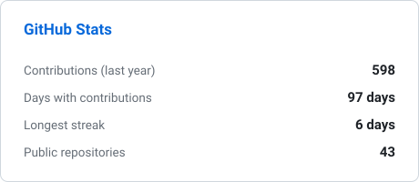
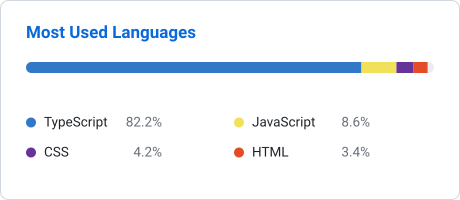

## Hello, Matheus Borges here! 👋

### Software Engineer: React, Next.js and TypeScript, with Node, PostgreSQL and applied AI (MCP).

I'm the sole frontend owner of a B2B cloud platform in production, and since November 2026 I also build backend features in NestJS and MongoDB. In my own projects I work across the stack and with AI integrations, directing AI agents from spec to production.

---

### 🚀 Featured Projects

| Project | What it is | Stack |
| :--- | :--- | :--- |
| **[MCP Barber Shop](https://github.com/MatheusBorgesDev/mcp-lab)** · [live](https://mcp-barber-shop.vercel.app) | Public MCP server: connect your own AI (claude.ai, ChatGPT) to book, reschedule and cancel on a shared schedule that updates live. No double booking under concurrent requests, row-level security on every table, 406 tests. | TypeScript · MCP SDK · Vercel Functions · Supabase Postgres · Upstash Redis |
| **[Wallety](https://github.com/MatheusBorgesDev/wallety)** 🚧 | Digital wallet API on a double-entry ledger, built so money is never created or lost under concurrent transfers and retried requests. Work in progress. | Express 5 · TypeScript · Prisma · PostgreSQL |

---

### 🛠️ Tech Stack

**Front-end**

**Back-end & Data**

**AI**

**Testing & Tooling**

---

### 📊 GitHub Stats

<picture>
  <source media="(prefers-color-scheme: dark)" srcset="assets/stats-dark.svg">
  
</picture>
<picture>
  <source media="(prefers-color-scheme: dark)" srcset="assets/languages-dark.svg">
  
</picture>

Cards are generated by a <a href=".github/workflows/stats.yml">GitHub Action</a> that runs daily and commits the SVGs to this repo, no third-party service involved.

---

### 📫 Contact me

